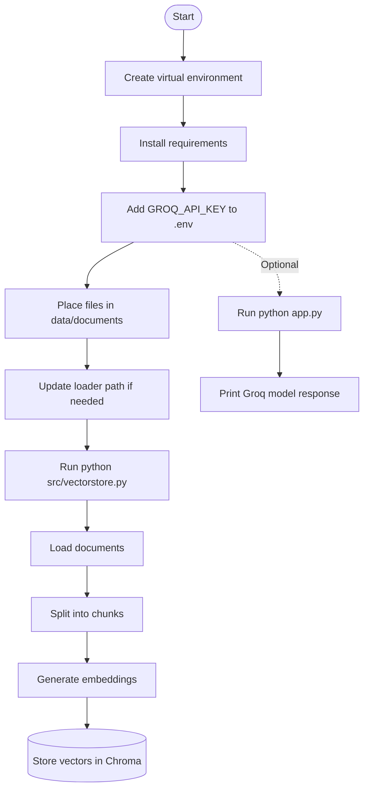

# Document-Grounded RAG

## Project summary

This repository is a lightweight document-grounded RAG prototype built with Python, LangChain, Hugging Face embeddings, ChromaDB, and Groq. It demonstrates the core pipeline for retrieval-augmented generation:

- load documents from a local folder
- split them into chunks
- generate embeddings
- store them in a vector database
- retrieve context for grounded responses

This project is designed as a beginner-friendly foundation for building more advanced document Q&A and AI assistants.

## Quick start

```bash
git clone https://github.com/gopalgupta46300-ui/Document-Grounded_RAG.git
cd Document-Grounded_RAG
python -m venv .venv
source .venv/bin/activate   # Windows: .venv\Scripts\activate
pip install -r requirements.txt
```

Create a `.env` file in the project root:

```env
GROQ_API_KEY=your_groq_api_key_here
```

Then build the vector store:

```bash
python src/vectorstore.py
```

Optional smoke test:

```bash
python app.py
```

## Commands

```bash
# install dependencies
pip install -r requirements.txt

# create vector database from documents
a python src/vectorstore.py

# optional Groq API smoke test
python app.py
```

## Project structure

```text
Document-Grounded_RAG/
├── app.py
├── requirements.txt
├── LICENSE
├── Readme.md
├── checks.json
├── data/
│   └── documents/
│       ├── company_policy.txt
│       └── phase3.txt
├── src/
│   ├── embeddings.py
│   ├── loader.py
│   ├── splitter.py
│   └── vectorstore.py
├── vectorstore/
├── .env
├── .gitignore
└── .venv/
```

## File responsibilities

- `app.py`: sample Groq usage and prompt smoke test
- `src/loader.py`: loads files from the documents directory
- `src/splitter.py`: splits documents into chunks with `RecursiveCharacterTextSplitter`
- `src/embeddings.py`: initializes the Hugging Face embedding model
- `src/vectorstore.py`: creates and persists the Chroma vector store
- `data/documents/`: place raw docs here (txt, pdf, docx)
- `vectorstore/`: persisted Chroma data

## Execution flow



## How the RAG pipeline works

1. Documents are loaded from `data/documents/`.
2. Text is chunked using a recursive splitter.
3. Each chunk is embedded using `sentence-transformers/all-MiniLM-L6-v2`.
4. Embeddings are stored in Chroma for similarity search.
5. A Groq-backed model can be used for generation or prompt testing.

## Setup details

### 1) Install dependencies

```bash
pip install -r requirements.txt
```

### 2) Add environment variables

```env
GROQ_API_KEY=your_key_here
```

### 3) Add source documents

Place text, PDF, or DOCX documents in:

```text
data/documents/
```

### 4) Fix local loader path if needed

The loader currently has a hardcoded Windows-path example:

```python
DOCUMENTS_PATH = Path(r"E:\Ultimate_Folder\demo-RAG-system\data\documents")
```

For portability, prefer:

```python
from pathlib import Path

DOCUMENTS_PATH = Path(__file__).resolve().parent.parent / "data" / "documents"
```

## Coding conventions

- Prefer small, focused functions and clear file boundaries.
- Keep data loading, chunking, embedding, and vector storage in separate modules.
- Use readable variable names and explicit paths.
- Do not hardcode machine-specific paths into shared code.
- Keep environment secrets in `.env`, not in source files.

## Boundaries and restrictions

- Never commit secrets or API keys to version control.
- Do not edit generated vector store artifacts manually.
- Do not add machine-specific absolute paths unless intentionally required for a local environment.
- Keep changes focused on the RAG pipeline rather than unrelated project files.

## Verification

Before considering work complete:

- ensure dependencies install cleanly
- confirm documents are loaded from the expected directory
- run the vector database generation command successfully
- verify the Groq API test works if using `app.py`

Example verification commands:

```bash
python src/vectorstore.py
python app.py
```

## Definition of done

A task is complete when:

- the change is scoped and relevant to the RAG workflow
- the project still installs and runs with the provided setup
- the pipeline successfully loads documents and creates embeddings
- no secrets or local-only paths are accidentally committed

## Dependencies

```text
langchain
langchain-groq
langchain-community
langchain-text-splitters
python-dotenv
chromadb
pypdf
sentence-transformers
langchain-huggingface
```

## Current state

This repository is a clean prototype for learning and experimentation. It is intentionally simple and easy to extend with:

- retriever logic for real query answering
- prompt templates and chat history
- metadata-aware document retrieval
- Streamlit or FastAPI UI
- stronger observability and evaluation

## Recommended next steps

- add a real question-answering flow using retrieval + LLM
- build a UI for document chat
- improve citations and source tracking
- support more document types and metadata
- move the project to a production-ready architecture

## License

This project is licensed under the MIT License. See `LICENSE` for details.
