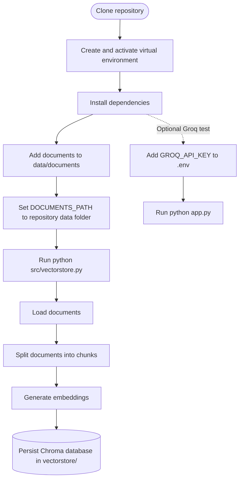

# Document-Grounded RAG

A lightweight Python prototype for preparing local documents for retrieval-augmented generation (RAG). It uses LangChain, Hugging Face embeddings, and ChromaDB; `app.py` is currently a separate Groq API smoke test, not a document-question-answering chat app.

## Run locally

### Prerequisites

- Python 3.11 or newer
- Git
- Internet access for installing packages and downloading the embedding model
- A Groq API key only if you want to run the optional `app.py` smoke test

### 1. Clone the repository

```bash
git clone https://github.com/gopalgupta46300-ui/Document-Grounded_RAG.git
cd Document-Grounded_RAG
```

### 2. Create and activate a virtual environment

**macOS / Linux**

```bash
python3 -m venv .venv
source .venv/bin/activate
```

**Windows PowerShell**

```powershell
py -3.11 -m venv .venv
.\.venv\Scripts\Activate.ps1
```

If PowerShell blocks activation, use Command Prompt instead:

```bat
.venv\Scripts\activate.bat
```

### 3. Install dependencies

```bash
python -m pip install --upgrade pip
python -m pip install -r requirements.txt
```

The current `requirements.txt` may need to be corrected before installation: `python 3.11.4` is a runtime version, not a pip package requirement. If pip reports an error on that line, remove it from the requirements file (or change it to a comment such as `# Python 3.11.4`). The Chroma integration and DOCX loader may also require these packages if they are not installed as transitive dependencies:

```bash
python -m pip install langchain-chroma docx2txt
```

### 4. Add documents

Put documents you want to index in `data/documents/`. The loader supports `.txt`, `.pdf`, and `.docx` files. The repository includes sample `.txt` files.

### 5. Point the loader at the repository's documents

Before indexing, update `DOCUMENTS_PATH` in `src/loader.py`. It currently points to a machine-specific Windows directory, so it will not find this repository's files on most computers.

Replace the existing `DOCUMENTS_PATH` assignment with this project-relative path:

```python
DOCUMENTS_PATH = Path(__file__).resolve().parent.parent / "data" / "documents"
```

### 6. Build the local vector store

From the repository root, with the virtual environment activated, run:

```bash
python src/vectorstore.py
```

The script loads supported documents, splits them into chunks, generates embeddings with `sentence-transformers/all-MiniLM-L6-v2`, and persists the Chroma database under `vectorstore/`. The first run may download the embedding model and take longer than subsequent runs.

### 7. (Optional) Run the Groq smoke test

Create a `.env` file in the repository root containing your Groq API key:

```env
GROQ_API_KEY=your_groq_api_key_here
```

Then run:

```bash
python app.py
```

This prints a sample model response. It does not currently query the documents or the Chroma vector store. Do not commit `.env` or expose your API key.

## Run flow



## Project structure

```text
Document-Grounded_RAG/
├── app.py                    # Groq API smoke test
├── requirements.txt          # Python dependencies
├── data/documents/           # Input TXT, PDF, and DOCX files
├── src/
│   ├── embeddings.py         # Hugging Face embedding model
│   ├── loader.py             # Document loading
│   ├── splitter.py           # Text chunking
│   └── vectorstore.py        # Chroma vector store creation
└── vectorstore/              # Generated local Chroma data
```

## Troubleshooting

- **No documents found:** confirm `data/documents/` contains supported files and `DOCUMENTS_PATH` points there.
- **Missing Groq key:** `GROQ_API_KEY` is only needed for `python app.py`; vector-store creation does not require it.
- **Import error for `langchain_chroma`:** install `langchain-chroma` in the active virtual environment.
- **DOCX loading error:** install `docx2txt`.
- **Slow first indexing run:** the embedding model may need to download the first time.

## License

This project is licensed under the MIT License. See `LICENSE` for details.
